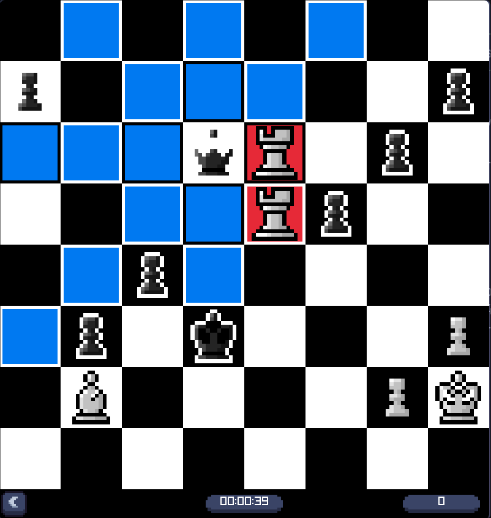

<h1 align="center">
  PuzzledChess
  <br>
  <sub>A chess puzzle trainer in C++ with raylib, powered by the Lichess puzzle database</sub>
</h1>

<p align="center">
  <a href="https://github.com/redsteadz/PuzzledChess/releases/latest"></a>
  <a href="https://github.com/redsteadz/PuzzledChess/releases"></a>
  <a href="https://github.com/redsteadz/PuzzledChess/actions"></a>
  
</p>

<p align="center">
  
</p>

<p align="center">
  <b><a href="#-download">Download</a></b> &nbsp;&middot;&nbsp;
  <a href="#-game-modes">Game modes</a> &nbsp;&middot;&nbsp;
  <a href="#-features">Features</a> &nbsp;&middot;&nbsp;
  <a href="#-building-from-source">Build it</a> &nbsp;&middot;&nbsp;
  <a href="https://github.com/redsteadz/PACMAN/releases">PACMAN</a>
</p>

---

## 📥 Download

Ready-to-play builds for both platforms. A 30,000 puzzle dataset is bundled in
every archive, so the game is playable the moment you open it.

| Platform | File | Requirements |
| --- | --- | --- |
| **Windows** | [`PuzzledChess-windows-x86_64.zip`](https://github.com/redsteadz/PuzzledChess/releases/latest/download/PuzzledChess-windows-x86_64.zip) | Windows 10+, 64-bit |
| **Linux** | [`PuzzledChess-linux-x86_64.tar.gz`](https://github.com/redsteadz/PuzzledChess/releases/latest/download/PuzzledChess-linux-x86_64.tar.gz) | glibc distro, OpenGL, X11 |

```bash
# Linux
tar -xzf PuzzledChess-linux-x86_64.tar.gz
cd PuzzledChess-linux-x86_64
./PuzzledChess
```

On Windows, unzip `PuzzledChess-windows-x86_64.zip` and double-click
`PuzzledChess.exe`. Both bundles unpack into a single folder with the game and
`assets/` side by side — run it from that folder and keep the two together.

raylib is statically linked into both builds, so nothing needs installing
alongside them. Every push to `main` is compiled for both platforms, and every
tagged release publishes both archives with SHA256 checksums.

👉 **[Full download page with system requirements →](https://redsteadz.github.io/PuzzledChess/)**

---

## 🎯 Game modes

Pick a mode from the main menu. Faster solves are worth more points, from 1000
for an instant answer down to 100 if you take longer than two minutes. Your best
score is remembered between runs.

| Mode | Rules |
| --- | --- |
| **One Shot** | A single incorrect move ends the run and returns you to the menu with the score reset |
| **Timed** | Solve as many puzzles as you can in a 60 second session |
| **No Limit** | No clock, no fail state. The right way to grind through new puzzles |

### Controls

| Input | Action |
| --- | --- |
| Left click | Select a piece, then one of the highlighted destination squares |
| `→` | Play the next expected move for you, then let the opponent reply |
| `Esc` | Close the window |

One Shot drops you back at the menu the moment you play a wrong move, and Timed
does the same when the 60 seconds run out. No Limit keeps going until you close
the window.

---

## ✨ Features

- **Real positions.** Puzzles are sampled from the
  [Lichess open puzzle database](https://database.lichess.org/#puzzles), so every
  position comes from an actual game rather than a synthetic one
- **Click-to-move board.** Pick a piece and the legal destinations highlight
  themselves in blue, with captures marked in red
- **Verified lines.** Your moves are checked against the stored solution, and the
  opponent's replies are animated back at you
- **Scoring that rewards speed**, with your best score carried across sessions
- **Animated pieces and sounds** for every move, capture and score event

---

## 🗄️ The puzzle database

The full Lichess collection is around 4 million puzzles — roughly 300 MB
compressed and well over a gigabyte as plain CSV. That is far too large to track
in git, so this repository ships a **random 30,000 puzzle subset** as
`assets/lichess_db_puzzle.csv`. The sample is drawn with reservoir sampling, so
it keeps the same difficulty distribution as the full set.

The game loads that file at startup and caches it in memory.

<details>
<summary><b>Using the full database</b></summary>

```bash
./scripts/fetch_puzzles.sh
```

That downloads and decompresses the full collection to
`assets/lichess_db_puzzle_full.csv`. Point the game at it with an environment
variable:

```bash
PUZZLEDCHESS_PUZZLES=./assets/lichess_db_puzzle_full.csv ./PuzzledChess
```

Or swap the files to make it the permanent dataset:

```bash
cp assets/lichess_db_puzzle_full.csv assets/lichess_db_puzzle.csv
```

</details>

<details>
<summary><b>Rebuilding the bundled sample</b></summary>

```bash
./scripts/sample_puzzles.py --input path/to/lichess_db_puzzle.csv.zst --count 30000
```

Passing `--input` is optional; without it the script downloads the archive
itself into `~/.cache/puzzledchess`.

</details>

---

## 🛠️ Building from source

You need a C++ compiler, CMake 3.16+ and raylib 5.x. If you would rather not
install raylib yourself, pass `-DPUZZLEDCHESS_USE_BUNDLED_RAYLIB=ON` and CMake
will fetch and compile a pinned copy for you.

```bash
git clone https://github.com/redsteadz/PuzzledChess.git
cd PuzzledChess
cmake -S . -B build -DCMAKE_BUILD_TYPE=Release
cmake --build build -j
./build/bin/PuzzledChess
```

<details>
<summary><b>Installing raylib</b></summary>

```bash
# Arch / CachyOS
sudo pacman -S cmake raylib

# Debian / Ubuntu
sudo apt install build-essential cmake libraylib-dev

# macOS
brew install cmake raylib
```

</details>

<details>
<summary><b>Cross-compiling a Windows build from Linux</b></summary>

The repository ships a MinGW-w64 toolchain file. Install the cross compiler,
point CMake at it, and add `PUZZLEDCHESS_STATIC_RUNTIME` to get a standalone
`.exe` with no DLLs to ship next to it.

```bash
sudo apt install g++-mingw-w64-x86-64

cmake -S . -B build \
      -DCMAKE_TOOLCHAIN_FILE=cmake/toolchain-mingw-x86_64.cmake \
      -DPUZZLEDCHESS_STATIC_RUNTIME=ON
cmake --build build -j
```

</details>

<details>
<summary><b>Useful CMake options</b></summary>

| Option | Default | What it does |
| --- | --- | --- |
| `CMAKE_BUILD_TYPE` | `Release` | `Debug` builds with symbols and no optimisation |
| `PUZZLEDCHESS_USE_BUNDLED_RAYLIB` | `OFF` | Compile a pinned raylib from source |
| `RAYLIB_GIT_TAG` | `5.5` | Which raylib tag to build |
| `PUZZLEDCHESS_STATIC_RUNTIME` | `OFF` | Fully static executable (MinGW) |

</details>

---

## 📁 Project layout

```
main.cpp                 Game loop, board state, move verification, menus
headers/
  animate.h              Animation manager and piece movement animations
  constant.h             Screen dimensions and shared constants
  console.h              Windows console bridging for the GUI-subsystem build
  database.h             Lichess CSV loading and random puzzle selection
  gui.h                  Buttons and text labels
  gui_menu.h, raygui.h   Vendored raygui widgets
  menu.h                 Menu layout definitions
  sound.h                Sound effect registry
assets/                  Piece textures, sounds and the puzzle dataset
scripts/                 Puzzle dataset tooling
docs/                    Download page published through GitHub Pages
```

---

## 📄 Data & license

Puzzle positions come from the
[Lichess open puzzle database](https://database.lichess.org/#puzzles).

Built with [raylib](https://www.raylib.com/) and
[raygui](https://github.com/raysan5/raygui) by
[raysan5](https://github.com/raysan5/raylib).

Licensed under the [GNU AGPL v3](LICENSE).